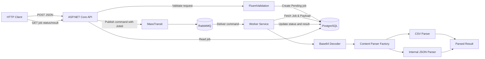
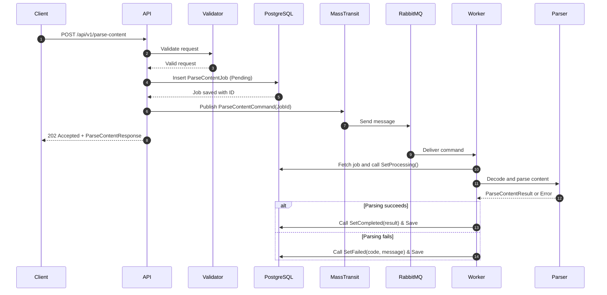
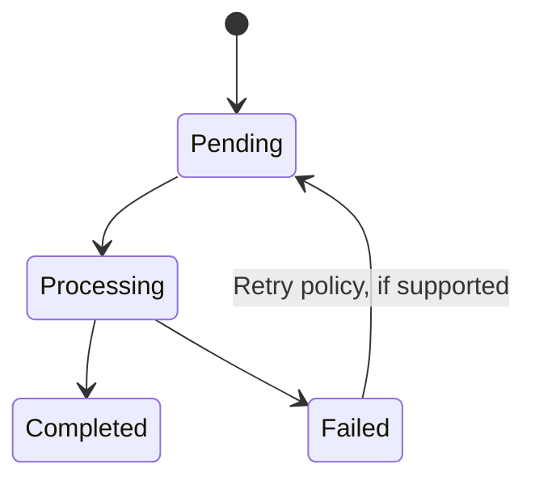
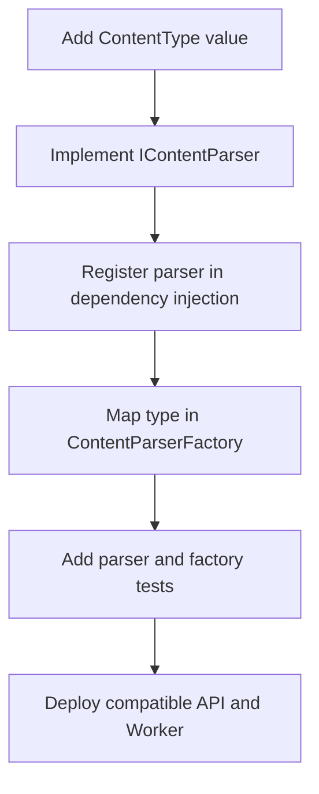

Here is the fully updated, complete, and consistent version of your `README.md` file. It incorporates all your actual project details—including the exact DTO and command signatures, domain entity methods, detailed custom error catalog, monadic `Result` pattern, FluentValidation pipeline, `GlobalExceptionMiddleware`, and planned logging middleware.

---

# GenerativeParser

GenerativeParser is an asynchronous .NET 8 content-parsing service that accepts Base64-encoded CSV or internal JSON payloads, persists each parsing job in PostgreSQL, and dispatches processing to a separate Worker through MassTransit and RabbitMQ. The HTTP API remains responsive while parsing runs in the background, and the job record provides a durable place to track processing status and results.

The solution combines Vertical Slice Architecture for feature-oriented organization with a decoupled API/Worker deployment model. Parsing strategies are selected through a factory, so supported formats can be extended without putting parser-specific logic into the HTTP endpoint or rewriting the message-processing pipeline.

## At a glance

* **API:** ASP.NET Core Minimal APIs, request validation, job creation, persistence, and asynchronous command publication.


* **Messaging:** MassTransit with RabbitMQ transports lightweight `ParseContentCommand` notifications (containing only the `JobId`) from the API to the Worker.


* **Worker:** A separate process consumes commands, loads the pending job from PostgreSQL, decodes Base64, selects a parser, and records the outcome.


* **Persistence:** PostgreSQL and EF Core store job state, payloads, and parsing results.


* **Parsing:** CSV and internal JSON parsers implement a common parser abstraction.


* **Extensibility:** Add a parser and register its content type with the parser factory; keep transport and endpoint logic format-agnostic.


* **Reliability:** Persistent jobs provide status tracking. For production-grade delivery guarantees, use an outbox, retries, dead-letter/error handling, and idempotent processing.


## Architecture at a glance



## Contents

* [Purpose and scope](https://www.google.com/search?q=%23purpose-and-scope)
* [Solution structure](https://www.google.com/search?q=%23solution-structure)
* [Architecture and key decisions](https://www.google.com/search?q=%23architecture-and-key-decisions)
* [Request and processing flow](https://www.google.com/search?q=%23request-and-processing-flow)
* [Job lifecycle and persistence](https://www.google.com/search?q=%23job-lifecycle-and-persistence)
* [Adding a new parser](https://www.google.com/search?q=%23adding-a-new-parser)
* [Reliability and production considerations](https://www.google.com/search?q=%23reliability-and-production-considerations)
* [Local development](https://www.google.com/search?q=%23local-development)
* [API contract](https://www.google.com/search?q=%23api-contract)

---

# Detailed documentation

## Purpose and scope

The project was created to demonstrate a secure and extensible content-parsing endpoint in C#/.NET. The core implementation focuses on accepting a JSON request, validating a declared content type, decoding Base64 content, parsing data with variable structure, and returning a normalized result.

The solution extends synchronous parsing into an asynchronous job-processing workflow. The API accepts and validates a request, stores a job, publishes a lightweight message containing only the `JobId`, and returns immediately without waiting for parsing to finish. A separately hosted Worker fetches the job from the database, performs the parsing, and updates the job record.

### Supported input formats

| Type | Purpose |
| --- | --- |
| `CSV` | Parse comma-separated tabular content into records |
| `INTERNAL_JSON` | Validate and parse the project's internal JSON content format |

The HTTP request body contains `contentType` and Base64-encoded `content`.

## Solution structure

The solution is organized into separate API, Worker, Contracts, Common, and Infrastructure areas:

```text
GenerativeParser/
├── API/
│   ├── Features/
│   │   └── ParseContent/
│   │       ├── Interfaces/
│   │       │   └── IParseContentHandler.cs
│   │       ├── Validation/
│   │       │   ├── ParseContentRequestValidator.cs
│   │       │   └── ParseContentValidationFilter.cs
│   │       ├── ParseContentEndpoint.cs
│   │       └── ParseContentHandler.cs
│   ├── Middleware/
│   │   └── GlobalExceptionMiddleware.cs
│   ├── Program.cs
│   └── appsettings.json
├── Contracts/
│   └── DTOs/
│       ├── ParseContentCommand.cs
│       ├── ParseContentRequest.cs
│       ├── ParseContentResponse.cs
│       ├── ParseContentResult.cs
│       └── ParsedItemDto.cs
├── WorkerService/
│   ├── Hubs/
│   │   └── ParseContentHub.cs
│   ├── ParseContent/
│   │   ├── Helpers/
│   │   │   ├── JobResultHandler.cs
│   │   │   └── UpdateJobStatusSender.cs
│   │   ├── Interfaces/
│   │   │   ├── IBase64Decoder.cs
│   │   │   ├── IContentParser.cs
│   │   │   └── IContentParserFactory.cs
│   │   ├── Parsers/
│   │   │   ├── CsvContentParser.cs
│   │   │   └── InternalJsonContentParser.cs
│   │   ├── Base64Decoder.cs
│   │   ├── ContentParserFactory.cs
│   │   └── ParseContentConsumer.cs
│   ├── ParserServiceExtensions.cs
│   └── Program.cs
├── Common/
│   ├── Errors/
│   │   ├── Error.cs
│   │   └── ParseContentErrors.cs
│   └── Result.cs
└── Infrastructure/
    └── ParseContent/
        ├── DataBaseContext/
        ├── Entities/
        │   └── ParseContentJob.cs
        └── Enums/
            └── JobStatus.cs

```

### API

The API project owns HTTP-specific behavior:

* Minimal API endpoint definitions and routing.


* Request DTO binding and FluentValidation execution via endpoint filters.


* The `ParseContentHandler`, which creates the `ParseContentJob`, persists it to PostgreSQL, and publishes `ParseContentCommand(job.Id)`.


* Custom global exception middleware for normalizing unexpected runtime failures.


The endpoint remains thin and does not decode Base64 or contain parsing logic; those are Worker responsibilities.

### Contracts

The Contracts project contains message and data-transfer types shared between processes:

* `ParseContentCommand`: Simple command contract carrying `Guid JobId`.
* `ParseContentRequest`: Inbound HTTP request payload (`ContentType`, `Content`).
* `ParseContentResponse`: Acceptance response (`JobId`, `Status`).
* `ParseContentResult` & `ParsedItemDto`: Normalized outcome wrappers storing dynamic row data inside an `IReadOnlyDictionary<string, object?>`.

### WorkerService

The Worker is a separately hosted process. Its consumer receives the command and coordinates the parsing workflow:

1. Load the persisted `ParseContentJob` from PostgreSQL using `JobId`.
2. Transition job state via `SetProcessing()`.
3. Decode the Base64 payload using `IBase64Decoder`.
4. Resolve the appropriate parser using `IContentParserFactory`.
5. Execute `IContentParser.Parse(...)`.
6. Record success via `SetCompleted(result)` or failure via `SetFailed(errorCode, errorMessage)`.

### Infrastructure and persistence

Contains EF Core database context, `ParseContentJob` entity, and `JobStatus` enum (`Pending`, `Processing`, `Completed`, `Failed`).

### Common

Contains domain abstractions shared across layers:

* `Result` / `Result<T>` monadic wrapper for explicit flow control.


* `Error` record and static catalog `ParseContentErrors`.


## Architecture and key decisions

### 1. Vertical Slice Architecture for the API feature

The API groups behavior by use case under `Features/ParseContent`, keeping handler, endpoint, and validators co-located.

### 2. Payload Offloading in Messaging

Rather than sending large Base64 strings across RabbitMQ, `ParseContentCommand` carries only `Guid JobId`. The Worker loads the job directly from PostgreSQL. This prevents broker message bloat and reduces memory overhead.

### 3. Monadic Result Pattern and Domain Error Model

The solution avoids throwing exceptions for expected business logic failures, request validation issues, or malformed input payloads. Instead, it uses a functional **Result Pattern** with centralized domain error objects to handle expected operational outcomes explicitly.

#### Error Abstraction and Domain Error Catalog

Domain errors are encapsulated in a lightweight `Error` type (defined in `Common/Errors/Error.cs`), combining a machine-readable string code and a descriptive error message.

The static `ParseContentErrors` class (in `Common/Errors/ParseContentErrors.cs`) acts as a single source of truth for all parsing-related failures:

* **Static Input Validation Errors:** Standardized static instances for request-level validation failures.


* `ParseContentErrors.EmptyContent` (`"Parse.EmptyContent"`): Triggered when the payload content is empty.


* `ParseContentErrors.InvalidBase64` (`"Parse.InvalidBase64"`): Triggered when Base64 decoding fails.


* `ParseContentErrors.UnsupportedType` (`"Parse.UnsupportedType"`): Triggered when an unknown content format is declared.


* **Dynamic Format Errors:** Factory methods for format-specific parsing failures.


* `ParseContentErrors.InvalidInternalJson(details)` (`"Parse.InvalidInternalJson"`): Encapsulates schema or JSON syntax failures.


* `ParseContentErrors.InvalidCsvFormat(details)` (`"Parse.InvalidCsvFormat"`): Encapsulates CSV structural errors.


* `ParseContentErrors.ProcessingFailed(details)` (`"Parse.ProcessingFailed"`): Encapsulates runtime processing failures.


#### The `Result` and `Result<TValue>` Monad

The non-generic `Result` and generic `Result<TValue>` classes (in `Common/Result.cs`) wrap the outcome of an operation:

```csharp
namespace Common
{
    public class Result
    {
        public bool IsSuccess { get; }
        public bool IsFailure => !IsSuccess;
        public Error Error { get; }

        protected Result(bool isSuccess, Error error)
        {
            if (isSuccess && error != Error.None)
                throw new ArgumentException("A success result cannot contain an Error.", nameof(error));
            if (!isSuccess && error == Error.None)
                throw new ArgumentException("A failure result must contain an Error.", nameof(error));

            IsSuccess = isSuccess;
            Error = error;
        }

        public static Result Success() => new(true, Error.None);
        public static Result Failure(Error error) => new(false, error);

        public static Result<TValue> Success<TValue>(TValue value) => new(value, true, Error.None);
        public static Result<TValue> Failure<TValue>(Error error) => new(false, error);
    }

    public class Result<TValue> : Result
    {
        private readonly TValue? _value;

        public TValue Value => IsSuccess
            ? _value!
            : throw new InvalidOperationException("The value of a failure result cannot be accessed.");

        protected internal Result(TValue? value, bool isSuccess, Error error) : base(isSuccess, error)
        {
            _value = value;
        }

        // Implicit conversions simplify returning values or errors directly
        public static implicit operator Result<TValue>(TValue? value) =>
            value is not null ? Success(value) : Failure<TValue>(Error.NullValue);

        public static implicit operator Result<TValue>(Error error) => Failure<TValue>(error);
    }
}

```

#### Key Benefits:

* **Implicit Casting:** Handlers can return either a successful DTO instance or an `Error` object directly; implicit operators automatically convert them into `Result<TValue>.Success` or `Result<TValue>.Failure`.


* **Encapsulated Failure Details:** Callers cannot access `.Value` on a failed result without throwing an explicit `InvalidOperationException`, guarding against null-reference bugs.

### 4. Controlled State Encapsulation

The `ParseContentJob` entity hides setters and enforces explicit transition invariants:

* `SetProcessing()`: Validates state is `Pending` before transitioning to `Processing`.
* `SetCompleted(result)`: Validates state is `Processing` before storing `ParseContentResult` and moving to `Completed`.
* `SetFailed(code, message)`: Validates state is `Processing` before storing error telemetry and moving to `Failed`.

### 5. Middleware and Pipeline Architecture

The HTTP request pipeline uses ASP.NET Core Minimal APIs combined with custom endpoint filters and middleware to enforce clean separation of concerns.

```text
                HTTP Request 
                     │
                     ▼
┌─────────────────────────────────────────┐
│       Request Logging Middleware        │  <-- Captures inbound HTTP metadata & execution timing (planned)
└────────────────────┬────────────────────┘
                     │
                     ▼
┌─────────────────────────────────────────┐
│       Global Exception Middleware       │  <-- Global try/catch; maps unhandled errors to Problem Details
└────────────────────┬────────────────────┘
                     │
                     ▼
┌─────────────────────────────────────────┐
│     ParseContentValidationFilter        │  <-- Executes FluentValidation before reaching the Handler
└────────────────────┬────────────────────┘
                     │
                     ▼
┌─────────────────────────────────────────┐
│          ParseContentHandler            │  <-- Creates job, persists to DB, publishes MassTransit command
└─────────────────────────────────────────┘

```

#### Request Validation Filter (FluentValidation)

* **Validation Execution:** Request validation is decoupled from endpoint handlers using FluentValidation (`ParseContentRequestValidator`) and a custom Minimal API filter (`ParseContentValidationFilter`).


* **Short-Circuiting:** The filter executes prior to handler invocation. If payload validation fails (e.g., empty content or unsupported format), the request is short-circuited immediately at the API boundary, returning an HTTP `400 Bad Request` with structured error details before any database or messaging operations take place.


#### Global Exception Middleware

* **Unhandled Infrastructure Errors:** `GlobalExceptionMiddleware` wraps the entire HTTP request execution. While domain logic uses `Result<T>` to handle expected failures, unexpected errors (such as database connectivity loss or message broker failures) bubble up to this middleware.


* **RFC 7807 Problem Details:** Unhandled exceptions are logged, intercepted, and translated into a standardized **RFC 7807 Problem Details** HTTP `500 Internal Server Error` response. Stack traces and internal implementation details are stripped out to protect sensitive system configuration.


#### Request Logging Middleware 

* **Structured Context Logging:** A dedicated logging middleware sits at the top of the HTTP pipeline to log inbound HTTP requests, paths, status codes, and execution duration.
* **Traceability & Correlation:** Attaches standard correlation identifiers (`TraceId`) to logging scope contexts so that API requests, PostgreSQL transactions, and background MassTransit execution cycles in the Worker can be traced end-to-end.


## Request and processing flow



### HTTP Endpoints

* `POST /api/v1/parse-content`: Validates and enqueues a parsing job; returns `202 Accepted` alongside the job identifier.
* `GET /api/v1/parse-content/{id}`: Retrieves job status and, when processing finishes, the parsed results or error details.

## Job lifecycle and persistence

A job tracks the complete life of a parsing operation through these states:



### Entity structure

A `ParseContentJob` encapsulates:

* `Id`: Primary job identifier.
* `Status`: Current state (`Pending`, `Processing`, `Completed`, `Failed`).
* `ContentType`: Declared content type.
* `Content`: Encoded payload or reference.
* `Result`: Parsed dynamic structure stored using PostgreSQL `jsonb`.
* `ErrorCode` / `ErrorMessage`: Safe, descriptive failure feedback.
* `CreatedAt` / `CompletedAt`: Audit timestamps.

## Adding a new parser

Adding support for a new format (e.g., XML) is contained within the Worker and Contracts layer:



1. Add the new content type to the shared contracts enum.
2. Implement `IContentParser` inside the Worker project.
3. Register the implementation with the DI container.
4. Update `ContentParserFactory` to map the type key to the implementation.
5. Add relevant unit and integration tests.
6. Update API input validation rules.

## Reliability and production considerations

* **Transactional Outbox:** Utilized to prevent state mismatches by writing job updates and outbound messages inside a single database transaction.
* **Idempotent Consumption:** Consumers check job state before executing to handle duplicate message deliveries gracefully.
* **Retry & Error Handling:** MassTransit rules handle temporary database or queue outages with configurable backoff policies.
* **Security & Observability:** Logs exclude sensitive payload content; structured telemetry relies on standard `JobId` correlation markers.

## Local development

### Prerequisites

* .NET 8 SDK
* PostgreSQL
* RabbitMQ

### Build and test

From the solution root:

```bash
dotnet restore
dotnet build
dotnet test

```

Run the application services:

```bash
dotnet run --project API
dotnet run --project WorkerService

```

## API contract

### Enqueue Parsing Job

```http
POST /api/v1/parse-content
Content-Type: application/json

```

```json
{
  "contentType": "CSV",
  "content": "bmFtZSxhZ2UKQWxpY2UsMzAK"
}

```

### Acceptance Response

```http
HTTP/1.1 202 Accepted
Content-Type: application/json

```

```json
{
  "jobId": "00000000-0000-0000-0000-000000000000",
  "status": "Pending"
}

```

### Messaging Contract

```csharp
public sealed record ParseContentCommand(Guid JobId);

```
