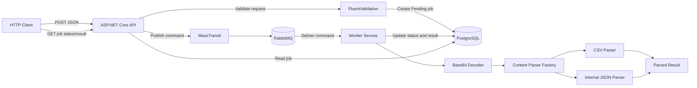
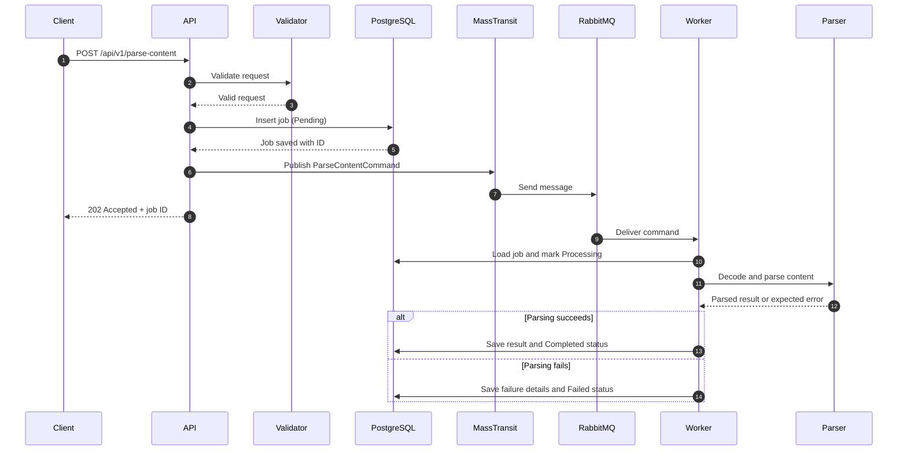
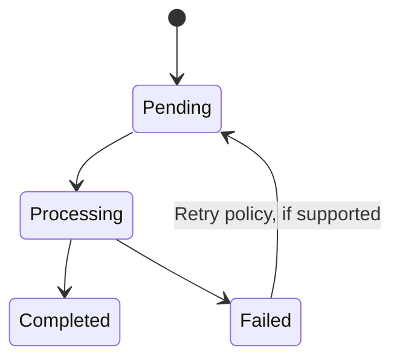
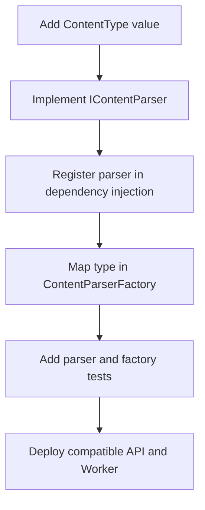

# GenerativeParser

GenerativeParser is an asynchronous .NET 8 content-parsing service that accepts Base64-encoded CSV or internal JSON payloads, persists each parsing job in PostgreSQL, and dispatches processing to a separate Worker through MassTransit and RabbitMQ. The HTTP API remains responsive while parsing runs in the background, and the job record provides a durable place to track processing status and results.

The solution combines Vertical Slice Architecture for feature-oriented organization with a decoupled API/Worker deployment model. Parsing strategies are selected through a factory, so supported formats can be extended without putting parser-specific logic into the HTTP endpoint or rewriting the message-processing pipeline.

## At a glance

* **API:** ASP.NET Core Minimal APIs, request validation, job creation, persistence, and asynchronous command publication.
* **Messaging:** MassTransit with RabbitMQ transports parsing commands from the API to the Worker.
* **Worker:** A separate process consumes commands, decodes Base64, selects a parser, and records the outcome.
* **Persistence:** PostgreSQL and EF Core store job state and parsing results.
* **Parsing:** CSV and internal JSON parsers implement a common parser abstraction.
* **Extensibility:** Add a parser and register its content type with the parser factory; keep transport and endpoint logic format-agnostic.
* **Reliability:** Persistent jobs provide status tracking. For production-grade delivery guarantees, use an outbox, retries, dead-letter/error handling, and idempotent processing.

## Architecture at a glance



## Contents

* [Purpose and scope](https://www.google.com/search?q=%23purpose-and-scope)
* [Solution structure](https://www.google.com/search?q=%23solution-structure)
* [Architecture and key decisions](https://www.google.com/search?q=%23architecture-and-key-decisions)
* [Request and processing flow](https://www.google.com/search?q=%23request-and-processing-flow)
* [Job lifecycle and persistence](https://www.google.com/search?q=%23job-lifecycle-and-persistence)
* [Adding a new parser](https://www.google.com/search?q=%23adding-a-new-parser)
* [Reliability and production considerations](https://www.google.com/search?q=%23reliability-and-production-considerations)
* [Local development](https://www.google.com/search?q=%23local-development)
* [API contract](https://www.google.com/search?q=%23api-contract)

---

# Detailed documentation

## Purpose and scope

The project was created to demonstrate a secure and extensible content-parsing endpoint in C#/.NET. The core implementation focuses on accepting a JSON request, validating a declared content type, decoding Base64 content, parsing data with variable structure, and returning a normalized result.

The solution extends synchronous parsing into an asynchronous job-processing workflow. The API accepts and validates a request, stores a job, publishes a message, and returns without waiting for parsing to finish. A separately hosted Worker performs the processing and updates the job record.

### Supported input formats

| Type | Purpose |
| --- | --- |
| `CSV` | Parse comma-separated tabular content into records |
| `INTERNAL_JSON` | Validate and parse the project's internal JSON content format |

The request body is JSON, while the `content` field contains the actual document encoded as Base64. These are two distinct formats: the outer HTTP payload is JSON; the inner content is selected by `type`.

## Solution structure

The solution is organized into separate API, Worker, Contracts, Common, and Infrastructure areas:

```text
GenerativeParser/
├── API/
│   ├── Features/
│   │   └── ParseContent/
│   │       ├── Interfaces/
│   │       │   └── IParseContentHandler.cs
│   │       ├── Validation/
│   │       │   ├── ParseContentRequestValidator.cs
│   │       │   └── ParseContentValidationFilter.cs
│   │       ├── ParseContentEndpoint.cs
│   │       └── ParseContentHandler.cs
│   ├── Middleware/
│   │   └── GlobalExceptionMiddleware.cs
│   ├── Contracts/
│   │   └── DTOs/
│   ├── Common/
│   │   ├── Errors/
│   │   └── Result.cs
│   ├── Program.cs
│   └── appsettings.json
├── Contracts/
│   └── DTOs/
│       ├── ParseContentCommand.cs
│       ├── ParseContentRequest.cs
│       ├── ParseContentResponse.cs
│       ├── ParseContentResult.cs
│       └── ParsedItemDto.cs
├── WorkerService/
│   ├── Hubs/
│   │   └── ParseContentHub.cs
│   ├── ParseContent/
│   │   ├── Helpers/
│   │   │   ├── JobResultHandler.cs
│   │   │   └── UpdateJobStatusSender.cs
│   │   ├── Interfaces/
│   │   │   ├── IBase64Decoder.cs
│   │   │   ├── IContentParser.cs
│   │   │   └── IContentParserFactory.cs
│   │   ├── Parsers/
│   │   │   ├── CsvContentParser.cs
│   │   │   └── InternalJsonContentParser.cs
│   │   ├── Base64Decoder.cs
│   │   ├── ContentParserFactory.cs
│   │   └── ParseContentConsumer.cs
│   ├── ParseServiceExtensions.cs
│   └── Program.cs
├── Common/
│   ├── Errors/
│   ├── Result.cs
│   └── Program.cs
└── Infrastructure/
    └── ParseContent/
        ├── DataBaseContext/
        ├── Entities/
        │   └── ParseContentJob.cs
        └── Enums/
            └── JobStatus.cs

```

### API

The API project owns HTTP-specific behavior:

* Minimal API endpoint definitions and routing.
* Request DTO binding and FluentValidation.
* The `ParseContentHandler`, which creates the job and initiates dispatch.
* Mapping expected application failures to the API response contract.
* Global exception handling for unexpected failures.

The endpoint remains thin and does not decode Base64 or contain parsing logic; those are Worker responsibilities.

### Contracts

The Contracts project contains message and data-transfer types shared between processes. `ParseContentCommand` is the contract used to request parsing.

Contracts remain independent of API and Worker implementation details. Changes to shared message schemas should be treated as compatibility changes because API and Worker may be deployed separately.

### WorkerService

The Worker is a separately hosted process. Its consumer receives the command and coordinates the parsing workflow:

1. Load the persisted job.
2. Mark it as processing.
3. Decode the Base64 content.
4. Resolve the parser for the declared content type.
5. Parse the document.
6. Persist the result or failure details and final status.

The Worker owns the parsing implementations and their dependencies, allowing the API and Worker to scale and deploy independently.

### Infrastructure and persistence

The Infrastructure area contains the EF Core database context, `ParseContentJob` entity, and job-status enum. The database is the durable source for job status and results; RabbitMQ is the transport for work notifications.

### Common

`Result<T>` and `Error` abstractions are shared where they are used across multiple projects to keep dependencies small and cohesive.

## Architecture and key decisions

### 1. Vertical Slice Architecture for the API feature

The API groups behavior by use case under `Features/ParseContent`, rather than distributing the endpoint, handler, validator, and related contracts across broad technical folders. This keeps changes to the parse-content use case discoverable and localized.

### 2. Separate API and Worker processes

The API handles short-lived HTTP work while the Worker handles asynchronous parsing. This offers key operational benefits:

* HTTP response time does not depend on parsing duration.
* Worker replicas can scale independently from API replicas.
* Parser dependencies and CPU-intensive work run outside the API process.
* RabbitMQ buffers messages when incoming volume spikes.

### 3. MassTransit with RabbitMQ

MassTransit provides application-level messaging abstractions, consumer integration, and configuration models. RabbitMQ acts as the message broker transporting commands from the API to the Worker.

### 4. Persist the job before dispatch

The API creates a job with a `Pending` status and saves it before publishing the command. This provides a stable tracking ID and allows the API to return immediately without waiting for parsing execution.

### 5. Factory-based parser selection

`IContentParser` defines a common parser abstraction, while `IContentParserFactory` resolves the appropriate parser for a given content type at runtime. This keeps the message consumer decoupled from concrete parser implementations.

### 6. Explicit result and error handling

The Result pattern models expected operational outcomes (e.g., malformed payloads or invalid schemas) clearly. Unexpected infrastructure failures bubble up to MassTransit's error pipelines to avoid marking failed processing attempts as acknowledged.

### 7. Validation at the boundary

FluentValidation and endpoint filters validate content type declarations, required inputs, and size limits before accepting processing jobs.

### 8. Minimal APIs and middleware

Minimal APIs provide a lightweight routing structure, while custom global exception middleware normalizes unhandled application errors into Standard Problem Details responses.

## Request and processing flow



### HTTP Endpoints

* `POST /api/v1/parse-content`: Validates and enqueues a parsing job; returns `202 Accepted` alongside the job identifier.
* `GET /api/v1/parse-content/{id}`: Retrieves job status and, when processing finishes, the parsed results or error details.

## Job lifecycle and persistence

A job tracks the complete life of a parsing operation through these states:



### Entity structure

A `ParseContentJob` encapsulates:

* `Id`: Primary job identifier.
* `Status`: Current state (`Pending`, `Processing`, `Completed`, `Failed`).
* `Type`: Declared content type.
* `Content`: Encoded payload or reference.
* `Result`: Parsed dynamic structure stored using PostgreSQL `jsonb`.
* `ErrorCode` / `ErrorMessage`: Safe, descriptive failure feedback.
* `CreatedAt` / `CompletedAt`: Audit timestamps.

## Adding a new parser

Adding support for a new format (e.g., XML) is contained within the Worker and Contracts layer:



1. Add the new content type to the shared contracts enum.
2. Implement `IContentParser` inside the Worker project.
3. Register the implementation with the DI container.
4. Update `ContentParserFactory` to map the type key to the implementation.
5. Add relevant unit and integration tests.
6. Update API input validation rules.

## Reliability and production considerations

* **Transactional Outbox:** Utilized to prevent state mismatches by writing job updates and outbound messages inside a single database transaction.
* **Idempotent Consumption:** Consumers check job state before executing to handle duplicate message deliveries gracefully.
* **Retry & Error Handling:** MassTransit rules handle temporary database or queue outages with configurable backoff policies.
* **Security & Observability:** Logs exclude sensitive payload content; structured telemetry relies on standard `JobId` correlation markers.

## Local development

### Prerequisites

* .NET 8 SDK
* PostgreSQL
* RabbitMQ

### Build and test

From the solution root:

```bash
dotnet restore
dotnet build
dotnet test

```

Run the application services:

```bash
dotnet run --project API
dotnet run --project WorkerService

```

## API contract

### Enqueue Parsing Job

```http
POST /api/v1/parse-content
Content-Type: application/json

```

```json
{
  "type": "CSV",
  "content": "bmFtZSxhZ2UKQWxpY2UsMzAK"
}

```

### Acceptance Response

```http
HTTP/1.1 202 Accepted
Content-Type: application/json

```

```json
{
  "jobId": "00000000-0000-0000-0000-000000000000",
  "status": "Pending"
}

```

### Messaging Contract

```csharp
public record ParseContentCommand(
    Guid JobId,
    string Content,
    ContentType ContentType);

```
