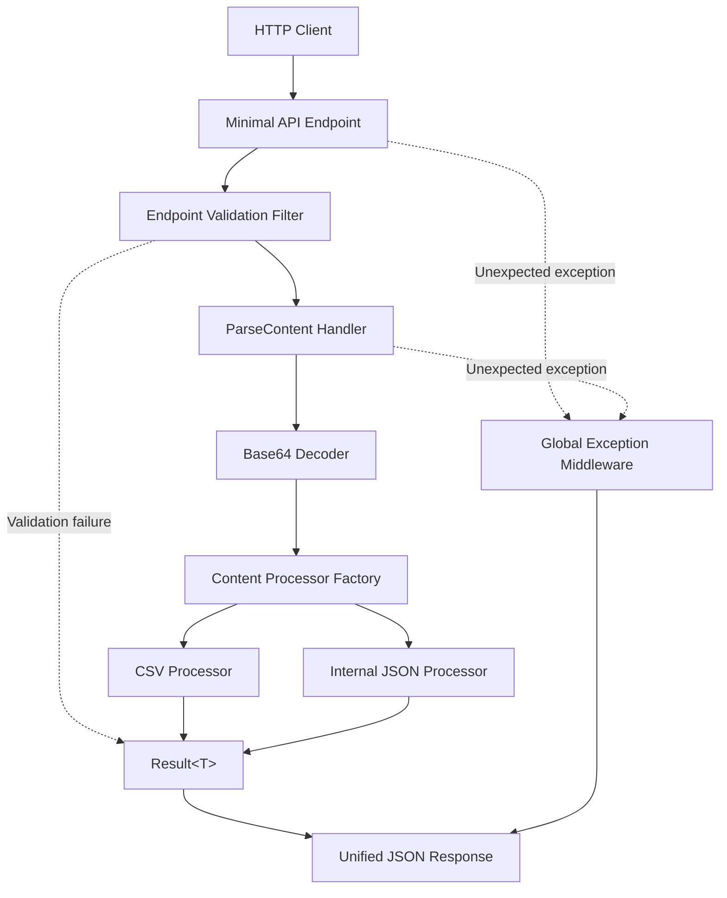

# GenerativeParser

A .NET 8 Web API for decoding and parsing Base64-encoded content into a unified JSON response. Supports CSV and an internal JSON format through an extensible, factory-based architecture.

The project demonstrates modern C# backend development with **Vertical Slice Architecture, Minimal APIs, FluentValidation, the Result pattern, and centralized error handling**.

## Key Features

* **REST API** — `POST /api/v1/parse-content` with JSON request and response contracts.
* **Base64 decoding** — validates and decodes Base64 content into UTF-8 text.
* **Multiple formats** — supports CSV and `INTERNAL_JSON`.
* **Extensible processors** — resolves format-specific content processors dynamically via a Factory Method pattern using dependency injection.
* **Input validation** — uses FluentValidation and an endpoint validation filter.
* **Explicit error handling** — represents expected failures with `Result<T>` and maps unexpected exceptions to RFC 7807 Problem Details.
* **Unit testing** — tests decoding, parsing, processor creation and resolution, and request orchestration.

## Technology Stack

| Technology | Purpose |
| --- | --- |
| C# / .NET 8 | Backend implementation |
| ASP.NET Core Minimal APIs | HTTP endpoint |
| FluentValidation | Request validation |
| System.Text.Json | JSON processing |
| Result pattern | Explicit success and failure handling |
| Factory Method pattern | Format-specific processor creation and lookup |
| Middleware | Global exception handling |
| xUnit / Moq / NSubstitute | Unit testing |

---

## Architecture

The application follows **Vertical Slice Architecture (VSA)**, organizing the parsing workflow around a feature rather than splitting its components into unrelated technical layers.

The `ParseContent` feature contains the request and response DTOs, endpoint, handler, validators, and content processors. Shared infrastructure provides the Result types, Base64 decoder, validation filter, and exception middleware.

### Design Patterns and Decisions

| Approach | Implementation |
| --- | --- |
| Vertical Slice Architecture | Groups parsing-related components within a single feature. |
| Minimal APIs | Defines lightweight endpoints without MVC controllers. |
| Result pattern | Represents expected parsing and validation failures without using exceptions for normal control flow. |
| Factory Method pattern | `ContentProcessorFactory` creates or resolves `IContentProcessor` instances based on `ContentType`. |
| FluentValidation | Validates requests before the handler executes. |
| Global exception middleware | Converts unexpected exceptions into safe Problem Details responses. |
| Custom Base64 decoder | Separates decoding and UTF-8 validation from parsing logic. |
| Dependency injection | Supplies handlers, factory, processors, validators, and infrastructure through the IoC container. |

### Architecture Diagram



---

## API Reference

### `POST /api/v1/parse-content`

Accepts a JSON request containing a content type and a Base64-encoded payload.

**Request contract**

```json
{
  "type": "CSV",
  "content": "SWRwLEltaWUsTmF6d2lza28NCjEsSmFuLEtvd2Fsc2tp"
}

```

| Field | Description |
| --- | --- |
| `type` | Supported format: `CSV` or `INTERNAL_JSON`. |
| `content` | Base64-encoded content to decode and parse. |

The request must use `Content-Type: application/json`.

### Processing Workflow

1. Validate the request and supported content type.
2. Decode the Base64 payload into UTF-8 text.
3. Request the required processor instance from `ContentProcessorFactory`.
4. Parse the content using the resolved processor.
5. Return the result in a unified JSON response.

### Response Contract

Successful processing returns HTTP `200 OK`.

```json
{
  "success": true,
  "processedItemsCount": 2,
  "data": [
    {
      "Id": "1",
      "Imie": "Jan",
      "Nazwisko": "Kowalski"
    },
    {
      "Id": "2",
      "Imie": "Anna",
      "Nazwisko": "Nowak"
    }
  ],
  "error": null
}

```

The response includes the operation status, number of processed items, parsed data, and an error field.

### Supported Formats

**CSV**

* Parses headers and records into a collection of key-value objects.
* Maps each row to its corresponding column names.
* Handles malformed structures, including missing headers and inconsistent column counts, according to the processor's validation rules.

**INTERNAL_JSON**

* Deserializes decoded JSON using `System.Text.Json`.
* Supports the expected internal JSON object or array structure.
* Returns a structured failure for invalid JSON or unsupported structures.

---

## Implementation Details

### 1. Request Validation

FluentValidation validates the incoming command before business logic executes. The `EndpointValidationFilter` integrates validation into the Minimal API request pipeline.

Validation covers required fields, supported content types, and invalid or empty payloads according to the request contract. This keeps request validation separate from decoding and format-specific parsing.

### 2. Base64 Decoding

The custom Base64 decoder encapsulates decoding and UTF-8 text conversion.

Its responsibilities include:

* Rejecting malformed Base64 input.
* Handling empty or invalid payloads according to the defined contract.
* Converting decoded bytes into text.
* Returning expected decoding failures through the Result pattern.

`Span<byte>` is used to reduce allocations when decoding payloads. UTF-8 validation ensures invalid byte sequences are safely caught.

### 3. Content Processor Factory (Factory Method)

`ContentProcessorFactory` acts as a factory method provider for resolving processor instances based on the `ContentType` enum.

```csharp
namespace GenerativeParser.Features.ParseContent
{
    public class ContentProcessorFactory : IContentProcessorFactory
    {
        private readonly IReadOnlyDictionary<ContentType, IContentProcessor> _processors;

        public ContentProcessorFactory(IEnumerable<IContentProcessor> processors)
        {
            _processors = new ReadOnlyDictionary<ContentType, IContentProcessor>(
                (IDictionary<ContentType, IContentProcessor>)processors
                .ToDictionary(p => p.Type, p => p)
            );
        }

        public Result<IContentProcessor> GetProcessor(ContentType type)
        {
            if (_processors.TryGetValue(type, out var processor))
            {
                return Result.Success(processor);
            }

            return ParseContentErrors.UnsupportedType;
        }
    }
}

```

Each processor implements the shared `IContentProcessor` interface. The factory encapsulates the lookup logic, making it trivial to introduce new processors into the system via dependency injection without modifying consumer code.

### 4. Result-Based Error Handling

Expected failures, such as invalid Base64 content or malformed CSV, are represented as explicit operation results rather than exceptions.

A generic `Result<T>` carries the successful value or failure information. The handler orchestrates decoding and parsing, while the endpoint translates the final result into an HTTP response.

Unexpected runtime exceptions are handled by `GlobalExceptionMiddleware`, which returns a safe RFC 7807 Problem Details response without exposing stack traces or internal exception details.

### 5. Middleware and Request Pipeline

The application uses a centralized request pipeline for cross-cutting concerns:

* Request validation before handler execution.
* Global handling of unexpected exceptions.
* Consistent mapping of expected failures to HTTP responses.
* Separation of HTTP concerns from decoding and parsing logic.

Expected parsing failures and unexpected infrastructure errors remain distinct so the API can return appropriate client and server responses.

---

## Testing

Unit tests are organized around the parsing feature and its independently testable components.

### Test Structure

```text
GenerativeParser.Tests/
└── Features/
    └── ParseContent/
        ├── Base64DecoderTests.cs
        ├── CsvContentProcessorTests.cs
        ├── InternalJsonContentProcessorTests.cs
        ├── ContentProcessorFactoryTests.cs
        └── ParseContentHandlerTests.cs

```

### Key Test Scenarios

| Test suite | Coverage |
| --- | --- |
| `Base64DecoderTests` | Valid UTF-8 decoding, empty input, malformed Base64, invalid UTF-8 where applicable. |
| `CsvContentProcessorTests` | Header mapping, row parsing, missing headers, inconsistent column counts. |
| `InternalJsonContentProcessorTests` | Valid JSON objects and arrays, malformed JSON, unsupported structures. |
| `ContentProcessorFactoryTests` | Correct processor instance creation/resolution and unsupported content types. |
| `ParseContentHandlerTests` | Orchestration of decoding, processor factory resolution, parsing, and failure propagation. |

Tests verify both successful processing and failure behavior, ensuring correct Result values and preventing malformed input from bubbling up as unhandled server errors.

---

## Local Development & Setup

### Prerequisites

* .NET 8 SDK ([Download .NET 8](https://dotnet.microsoft.com/download/dotnet/8.0))
* Git

### Clone the Repository

```bash
git clone https://github.com/DaniilHed/GenerativeParser.git
cd GenerativeParser

```

### Restore Dependencies

```bash
dotnet restore

```

### Run the Application

```bash
dotnet run --project GenerativeParser/GenerativeParser.csproj

```

After the application starts, open Swagger UI in your browser:

```text
https://localhost:7157/swagger

```

*(Port may vary depending on local launch settings).*

---

## Usage Examples

Use the HTTPS URL output by `dotnet run` (e.g., `https://localhost:7157`).

### Example 1: Parse CSV

Payload contents (`Id,Imie,Nazwisko\n1,Jan,Kowalski`):

```bash
curl -X POST "https://localhost:7157/api/v1/parse-content" \
  -H "Content-Type: application/json" \
  -d '{
    "type": "CSV",
    "content": "SWRwLEltaWUsTmF6d2lza28NCjEsSmFuLEtvd2Fsc2tp"
  }' \
  -k

```

Expected outcome: `200 OK` with parsed records in the response body.

### Example 2: Parse Internal JSON

Payload contents (`[{"id":1,"name":"Test Item"}]`):

```bash
curl -X POST "https://localhost:7157/api/v1/parse-content" \
  -H "Content-Type: application/json" \
  -d '{
    "type": "INTERNAL_JSON",
    "content": "W3siaWQiOjEsIm5hbWUiOiJUZXN0IEl0ZW0ifV0="
  }' \
  -k

```

Expected outcome: `200 OK` with structured items.

### Example 3: Invalid Base64

```bash
curl -X POST "https://localhost:7157/api/v1/parse-content" \
  -H "Content-Type: application/json" \
  -d '{
    "type": "CSV",
    "content": "Invalid_Base64!!!"
  }' \
  -k

```

Expected outcome: `400 Bad Request` with structured error details.

---

## Running Unit Tests

Run all unit tests:

```bash
dotnet test

```

For detailed test execution logs:

```bash
dotnet test --logger "console;verbosity=detailed"

```

---

## Project Goals

GenerativeParser demonstrates how to build an extensible parsing API with clear separation of concerns and predictable failure handling.

The main engineering objectives are:

* Keep format-specific parsing independent of the HTTP layer.
* Make new content formats easy to add through the factory processor abstraction.
* Validate requests before executing business logic.
* Represent expected parsing failures explicitly using the Result pattern.
* Handle unexpected exceptions centrally and safely.
* Test decoding, factory resolution, parsing, and orchestration independently.
