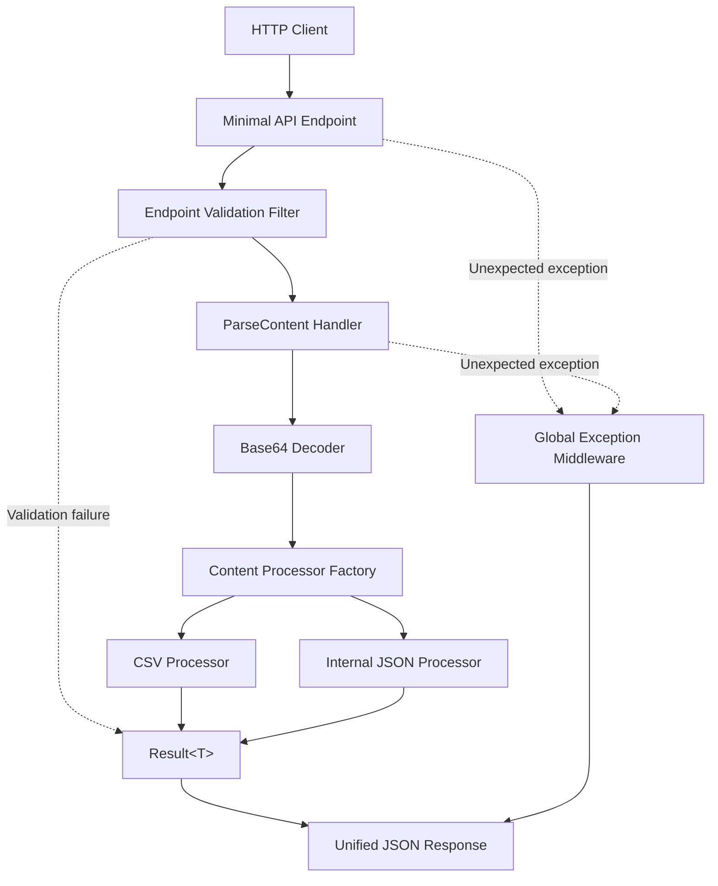

# GenerativeParser

A .NET 8 Web API for decoding and parsing Base64-encoded content into a unified JSON response. Supports CSV and an internal JSON format through an extensible, processor-based architecture.

The project demonstrates modern C# backend development with **Vertical Slice Architecture, Minimal APIs, FluentValidation, the Result pattern, and centralized error handling**.

## Key Features

- **REST API** — `POST /api/v1/parse-content` with JSON request and response contracts.
- **Base64 decoding** — validates and decodes Base64 content into UTF-8 text.
- **Multiple formats** — supports CSV and `INTERNAL_JSON`.
- **Extensible processors** — resolves format-specific processors through a dictionary-based factory.
- **Input validation** — uses FluentValidation and an endpoint validation filter.
- **Explicit error handling** — represents expected failures with `Result<T>` and maps unexpected exceptions to RFC 7807 Problem Details.
- **Unit testing** — tests decoding, parsing, processor resolution, and request orchestration.

## Technology Stack

| Technology | Purpose |
|---|---|
| C# / .NET 8 | Backend implementation |
| ASP.NET Core Minimal APIs | HTTP endpoint |
| FluentValidation | Request validation |
| System.Text.Json | JSON processing |
| Result pattern | Explicit success and failure handling |
| Processor Factory | Format-specific processor selection |
| Middleware | Global exception handling |
| xUnit and Moq/NSubstitute | Unit testing, depending on the libraries used |

---

## Architecture

The application follows **Vertical Slice Architecture (VSA)**, organizing the parsing workflow around a feature rather than splitting its components into unrelated technical layers.

The `ParseContent` feature contains the request and response DTOs, endpoint, handler, validators, and content processors. Shared infrastructure provides the Result types, Base64 decoder, validation filter, and exception middleware.

### Design Patterns and Decisions

| Approach | Implementation |
|---|---|
| Vertical Slice Architecture | Groups parsing-related components within a single feature. |
| Minimal APIs | Defines lightweight endpoints without MVC controllers. |
| Result pattern | Represents expected parsing and validation failures without using exceptions for normal control flow. |
| Processor Factory | Resolves `IContentProcessor` implementations using `ContentType` and an `IReadOnlyDictionary`. |
| Strategy pattern | Encapsulates format-specific parsing behavior behind a common processor interface. |
| FluentValidation | Validates requests before the handler executes. |
| Global exception middleware | Converts unexpected exceptions into safe Problem Details responses. |
| Custom Base64 decoder | Separates decoding and UTF-8 validation from parsing logic. |
| Dependency injection | Supplies handlers, processors, validators, and infrastructure through the IoC container. |

### Architecture Diagram



---

## API Reference

### `POST /api/v1/parse-content`

Accepts a JSON request containing a content type and a Base64-encoded payload.

**Request contract**

```json
{
  "type": "CSV",
  "content": "SWRwLEltaWUsTmF6d2lza28NCjEsSmFuLEtvd2Fsc2tp"
}
```

| Field | Description |
|---|---|
| `type` | Supported format: `CSV` or `INTERNAL_JSON`. |
| `content` | Base64-encoded content to decode and parse. |

The request must use `Content-Type: application/json`.

### Processing Workflow

1. Validate the request and supported content type.
2. Decode the Base64 payload into UTF-8 text.
3. Resolve the appropriate processor through `ContentProcessorFactory`.
4. Parse the content according to the selected format.
5. Return the result in a unified JSON response.

### Response Contract

Successful processing returns HTTP `200 OK`.

```json
{
  "success": true,
  "processedItemsCount": 2,
  "data": [
    {
      "Id": "1",
      "Imie": "Jan",
      "Nazwisko": "Kowalski"
    },
    {
      "Id": "2",
      "Imie": "Anna",
      "Nazwisko": "Nowak"
    }
  ],
  "error": null
}
```

The response includes the operation status, number of processed items, parsed data, and an error field.

### Supported Formats

**CSV**

- Parses headers and records into a collection of key-value objects.
- Maps each row to its corresponding column names.
- Handles malformed structures, including missing headers and inconsistent column counts, according to the processor's validation rules.

**INTERNAL_JSON**

- Deserializes decoded JSON using `System.Text.Json`.
- Supports the expected internal JSON object or array structure.
- Returns a structured failure for invalid JSON or unsupported structures.

---

## Implementation Details

### 1. Request Validation

FluentValidation validates the incoming command before business logic executes. The `EndpointValidationFilter` integrates validation into the Minimal API request pipeline.

Validation should cover required fields, supported content types, and invalid or empty payloads according to the request contract.

This keeps request validation separate from decoding and format-specific parsing.

### 2. Base64 Decoding

The custom Base64 decoder encapsulates decoding and UTF-8 text conversion.

Its responsibilities include:

- Rejecting malformed Base64 input.
- Handling empty or invalid payloads according to the defined contract.
- Converting decoded bytes into text.
- Returning expected decoding failures through the Result pattern.

Using `Span<byte>` where appropriate can reduce intermediate allocations, particularly when decoding larger payloads. UTF-8 validation should be explicit if malformed byte sequences must be rejected rather than replaced.

### 3. Processor Factory

`ContentProcessorFactory` selects a parser based on the `ContentType` enum.

The factory uses a dictionary-backed lookup rather than a long conditional statement:

```csharp
IReadOnlyDictionary<ContentType, IContentProcessor>
```

Each processor implements the shared `IContentProcessor` contract, allowing new formats to be introduced without rewriting the main handler.

The factory and processors are registered through dependency injection.

### 4. Result-Based Error Handling

Expected failures, such as invalid Base64 content or malformed CSV, are represented as explicit operation results rather than exceptions.

A generic `Result<T>` carries the successful value or failure information. The handler orchestrates decoding and parsing, while the endpoint translates the final result into an HTTP response.

Unexpected runtime exceptions are handled by `GlobalExceptionMiddleware`, which returns a safe RFC 7807 Problem Details response without exposing stack traces or internal exception details.

### 5. Middleware and Request Pipeline

The application uses a centralized request pipeline for cross-cutting concerns:

- Request validation before handler execution.
- Global handling of unexpected exceptions.
- Consistent mapping of expected failures to HTTP responses.
- Separation of HTTP concerns from decoding and parsing logic.

Expected parsing failures and unexpected infrastructure errors should remain distinct so the API can return appropriate client and server responses.

---

## Testing

Unit tests are organized around the parsing feature and its independently testable components.

### Test Structure

```text
GenerativeParser.Tests/
└── Features/
    └── ParseContent/
        ├── Base64DecoderTests.cs
        ├── CsvContentProcessorTests.cs
        ├── InternalJsonContentProcessorTests.cs
        ├── ContentProcessorFactoryTests.cs
        └── ParseContentHandlerTests.cs
```

### Key Test Scenarios

| Test suite | Coverage |
|---|---|
| `Base64DecoderTests` | Valid UTF-8 decoding, empty input, malformed Base64, invalid UTF-8 where applicable. |
| `CsvContentProcessorTests` | Header mapping, row parsing, missing headers, inconsistent column counts. |
| `InternalJsonContentProcessorTests` | Valid JSON objects and arrays, malformed JSON, unsupported structures. |
| `ContentProcessorFactoryTests` | Correct processor resolution and unsupported content types. |
| `ParseContentHandlerTests` | Orchestration of decoding, processor selection, parsing, and failure propagation. |

Tests should verify both successful processing and failure behavior, including correct Result values and ensuring malformed input does not become an unhandled server error.

---

## Running Locally

### Prerequisites

- .NET 8 SDK or a compatible newer SDK.
- Git.

### Run the API

```bash
git clone https://github.com/<your-username>/GenerativeParser.git
cd GenerativeParser

dotnet restore
dotnet build
dotnet run --project GenerativeParser
```

Replace the repository URL and project path if your actual solution structure differs.

Use the HTTPS address printed by the application when sending local requests. The examples below assume `https://localhost:7112`.

### Example 1: Parse CSV

The following Base64 payload represents:

```csv
Id,Imie,Nazwisko
1,Jan,Kowalski
2,Anna,Nowak
```

```bash
curl -X POST "https://localhost:7112/api/v1/parse-content" \
  -H "Content-Type: application/json" \
  -d '{
    "type": "CSV",
    "content": "SWRwLEltaWUsTmF6d2lza28NCjEsSmFuLEtvd2Fsc2tp"
  }' \
  -k
```

Expected outcome: `200 OK`, two processed records, and parsed objects in the response.

### Example 2: Parse Internal JSON

The following Base64 payload represents `[{"id":1,"name":"Test Item"}]`.

```bash
curl -X POST "https://localhost:7112/api/v1/parse-content" \
  -H "Content-Type: application/json" \
  -d '{
    "type": "INTERNAL_JSON",
    "content": "W3siaWQiOjEsIm5hbWUiOiJUZXN0IEl0ZW0ifV0="
  }' \
  -k
```

Expected outcome: `200 OK` with one processed item.

### Example 3: Invalid Base64

```bash
curl -X POST "https://localhost:7112/api/v1/parse-content" \
  -H "Content-Type: application/json" \
  -d '{
    "type": "CSV",
    "content": "Invalid_Base64!!!"
  }' \
  -k
```

Expected outcome: `400 Bad Request` with a structured error response, assuming decoding failures are mapped to HTTP 400 by the endpoint.

> `-k` disables TLS certificate verification and should be used only for local development with an untrusted development certificate. For a trusted local certificate, omit this flag.

### Run Unit Tests

```bash
dotnet test
```

Run tests for the specific test project if it is not automatically discovered by the solution.

---

## Project Goals

GenerativeParser demonstrates how to build an extensible parsing API with clear separation of concerns and predictable failure handling.

The main engineering objectives are:

- Keep format-specific parsing independent of the HTTP layer.
- Make new content formats easy to add through the processor abstraction.
- Validate requests before executing business logic.
- Represent expected parsing failures explicitly.
- Handle unexpected exceptions centrally and safely.
- Test decoding, parsing, processor selection, and orchestration independently.

The result is a compact backend architecture designed to remain understandable and extensible as additional content formats and validation requirements are introduced.

# Local Development & Setup

## Prerequisites

- .NET 8 SDK

Download the SDK:

https://dotnet.microsoft.com/download/dotnet/8.0

## Clone the Repository

```bash
git clone https://github.com/DaniilHed/GenerativeParser.git
cd GenerativeParser
```

## Restore Dependencies

```bash
dotnet restore
```

## Run the Application

```bash
dotnet run --project GenerativeParser/GenerativeParser.csproj
```

After the application starts, open the Swagger UI using the URL displayed in the console, for example:

```
https://localhost:7157/swagger
```

> **Note:** The port may vary depending on your local launch profile.

## Run Tests

Run all unit tests:

```bash
dotnet test
```

To display detailed test output:

```bash
dotnet test --logger "console;verbosity=detailed"
```
